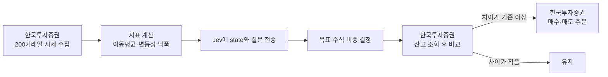

# MoneyPrinter

**TIGER 미국S&P500 (360750)** 하나만 매매하는 자동 리밸런싱 앱입니다.

지수 ETF는 종목 고르기보다 언제 얼마나 들고 있느냐가 수익을 좌우합니다. MoneyPrinter는 최근 200거래일 데이터를 TypeSafe의 판단 모델 **Jev**에 넘겨 **주식 비중과 현금 비중**을 정하게 하고, 앱은 정해진 비중에 맞춰 **한국투자증권 Open API**로 기계적으로 주문합니다.

> 판단은 Jev가, 실행은 코드가 합니다. 코드는 Jev의 답을 해석하지 않고 정해진 규칙대로만 움직입니다.

## 동작 흐름



1. **데이터 수집**: 한국투자증권 API로 360750의 최근 200거래일 일봉(종가, 거래량)을 가져옵니다.
2. **지표 계산**: 원본 시세와 함께, 판단에 쓸 숫자를 코드로 미리 계산합니다.
   - 현재가와 20·60·120·200일 이동평균, 각 이동평균과의 괴리율
   - 200일 이동평균의 기울기
   - 20일·60일 변동성
   - 200일 고점 대비 낙폭
   - 1·3·6개월 수익률
3. **Jev 판단**: 위 데이터를 `state`로, 비중 질문을 `questions`로 보냅니다.
4. **목표 비중 결정**: Jev가 고른 주식 비중이 목표가 되고, 나머지는 현금입니다.
5. **리밸런싱**: 한국투자증권 계좌의 주식·현금 비율과 목표를 비교해, 차이가 기준(예: 5%p)을 넘을 때만 주문합니다.

## 한국투자증권 Open API

시세 조회, 잔고 조회, 주문을 모두 [한국투자증권 KIS Developers](https://apiportal.koreainvestment.com) Open API로 처리합니다.

| 서버 | 주소 |
| --- | --- |
| 실전투자 | `https://openapi.koreainvestment.com:9443` |
| 모의투자 | `https://openapivts.koreainvestment.com:29443` |

쓰는 API는 다음과 같습니다. `tr_id`는 실전과 모의가 다릅니다.

| 용도 | 메서드·경로 | tr_id (실전 / 모의) |
| --- | --- | --- |
| 접근 토큰 발급 | `POST /oauth2/tokenP` | - |
| 현재가 | `GET /uapi/domestic-stock/v1/quotations/inquire-price` | `FHKST01010100` |
| 일봉 (200거래일) | `GET /uapi/domestic-stock/v1/quotations/inquire-daily-itemchartprice` | `FHKST03010100` |
| 주식 잔고 | `GET /uapi/domestic-stock/v1/trading/inquire-balance` | `TTTC8434R` / `VTTC8434R` |
| 매수 가능 금액 | `GET /uapi/domestic-stock/v1/trading/inquire-psbl-order` | `TTTC8908R` / `VTTC8908R` |
| 현금 매수 주문 | `POST /uapi/domestic-stock/v1/trading/order-cash` | `TTTC0012U` / `VTTC0012U` |
| 현금 매도 주문 | `POST /uapi/domestic-stock/v1/trading/order-cash` | `TTTC0011U` / `VTTC0011U` |

알아 둘 점:

- 모든 요청에 `appkey`, `appsecret`, `Authorization: Bearer <접근 토큰>`, `tr_id` 헤더가 필요합니다.
- 접근 토큰은 약 24시간 유효하고, 발급 요청은 1분에 1회로 제한됩니다. 토큰을 저장해 두고 만료될 때만 다시 발급합니다.
- 일봉 조회는 한 번에 최대 100건만 돌려줍니다. 200거래일을 받으려면 기간을 나눠 두 번 이상 호출합니다. 수정주가(`fid_org_adj_prc=0`)로 받아야 분배금 등으로 인한 가격 왜곡이 없습니다.
- 초당 호출 수 제한이 있고, 모의투자는 실전보다 더 낮습니다.
- 주문 수량은 1주 단위입니다. 목표 금액을 현재가로 나눈 뒤 내림해 수량을 정합니다.
- 주문 `tr_id`는 한국투자증권이 바꾼 적이 있으니, 구현 전에 KIS Developers 문서에서 최신 값을 확인합니다.

현재가, 일봉, 잔고 조회는 [JSMacroChart](https://github.com/didwns7347/MacroTrade)의 `KoreaInvestments` 모듈에 이미 구현돼 있어 참고해 옮겨 올 수 있습니다. 매수 가능 금액 조회와 주문은 새로 만들어야 합니다.

## Jev에게 묻는 방식

Jev는 문장을 생성하지 않고, 정해 둔 선택지에 확률을 매겨 답합니다. 그래서 비중을 숫자로 직접 묻지 않고 **구간 중 하나를 고르는 Choice 질문**으로 묻습니다.

```json
{
  "model": "jev-latest",
  "state": {
    "ticker": "360750",
    "name": "TIGER S&P500",
    "as_of": "2026-10-08",
    "indicators": {
      "price": 21450,
      "ma200": 19820,
      "price_vs_ma200_pct": 8.2,
      "ma200_slope_20d_pct": 1.4,
      "volatility_20d_pct": 14.1,
      "drawdown_from_200d_high_pct": -2.3
    },
    "closes_200d": [19800, 19850, "..."]
  },
  "questions": {
    "stock_weight": {
      "type": "choice",
      "instructions": "Given the last 200 trading days of this S&P 500 ETF, what share of the portfolio should be held in the ETF (the rest in cash) for the next month?",
      "criteria": {
        "0": "Fully defensive, hold cash",
        "25": "Mostly cash",
        "50": "Balanced",
        "75": "Mostly invested",
        "100": "Fully invested"
      }
    },
    "regime": {
      "type": "choice",
      "instructions": "What is the current market regime?",
      "criteria": {
        "uptrend": "Sustained rise above long-term average",
        "range": "Sideways, no clear trend",
        "downtrend": "Sustained fall below long-term average"
      }
    }
  }
}
```

- `stock_weight`의 `choice`가 목표 주식 비중(%)입니다.
- `confidence`가 낮으면(예: 0.5 미만) 비중을 바꾸지 않고 기존 비중을 유지합니다.
- `regime`은 주문에 직접 쓰지 않고, 판단 근거를 기록하는 용도입니다.
- Jev는 영어 입력에서 정확도가 가장 높아서 질문은 영어로 씁니다.
- 매 판단마다 응답의 `model` 필드(예: `jev-1.13.0`)를 함께 기록합니다. `jev-latest`는 새 버전이 나오면 바뀌기 때문입니다.

## 안전장치

Jev의 답과 상관없이 코드가 항상 지키는 규칙입니다.

| 규칙 | 내용 |
| --- | --- |
| 판단 주기 | 하루 1회, 장 마감 후 판단하고 다음 거래일 정규장(09:00~15:30)에 주문 |
| 최소 변경 폭 | 목표와 현재 비중 차이가 5%p 미만이면 주문하지 않음 |
| 1회 변경 한도 | 한 번에 비중을 최대 50%p까지만 바꿈 |
| 데이터 검증 | 시세가 200일치보다 적거나 오래됐으면 판단하지 않음 |
| Jev 장애 | 응답이 없거나 에러면 기존 비중 유지 |
| 주문 실패 | 한국투자증권 주문이 거절되면 재주문하지 않고 기록 후 다음 판단까지 대기 |
| 모의 모드 | 기본은 한국투자증권 모의투자 서버. 실전 서버는 설정으로 명시적으로 켜야 함 |
| 기록 | 입력 데이터, Jev 응답, 주문 결과를 모두 저장 |

## 진행 상황

- [x] Jev(TypeSafe) API 클라이언트 (`MoneyPrinter/Jev`)
- [x] 공통 네트워킹 모듈 (`MoneyPrinter/Networking`)
- [x] Jev API 키 설정 (`JevSecrets.xcconfig`)
- [ ] 한국투자증권 앱키·계좌 설정
- [ ] 한국투자증권 접근 토큰 발급과 저장
- [ ] 360750 200거래일 시세 수집 (한국투자증권 일봉 API)
- [ ] 지표 계산
- [ ] Jev 비중 판단 로직
- [ ] 한국투자증권 잔고·매수 가능 금액 조회
- [ ] 한국투자증권 매수·매도 주문
- [ ] 리밸런싱 엔진과 안전장치
- [ ] 판단·주문 기록과 화면
- [ ] 모의투자로 검증 후 실계좌 전환

## 프로젝트 구조

```
MoneyPrinter/
├── MoneyPrinter/
│   ├── Jev/            # Jev API 요청·응답 모델과 클라이언트
│   ├── Networking/     # 공통 HTTP 클라이언트, 재시도, 에러
│   ├── ContentView.swift
│   └── MoenyPrinter.swift
├── MoneyPrinter.xcconfig          # 빌드 설정 (JevSecrets.xcconfig를 읽음)
├── JevSecrets.example.xcconfig    # API 키 템플릿
└── JevSecrets.xcconfig            # 실제 API 키 (git에 올라가지 않음)
```

## 시작하기

1. 키 파일을 만듭니다.

   ```bash
   cp JevSecrets.example.xcconfig JevSecrets.xcconfig
   ```

2. `JevSecrets.xcconfig`에 [TypeSafe 콘솔](https://console.typesafe.ai/keys)에서 발급한 키를 넣습니다.

   ```
   TYPESAFE_API_KEY = 발급받은_키
   ```

3. [KIS Developers](https://apiportal.koreainvestment.com)에서 Open API를 신청하고 앱키(App Key), 앱시크릿(App Secret), 계좌번호를 준비합니다. 처음에는 모의투자 계좌로 신청합니다. 한국투자증권 연동이 구현되면 이 값들도 같은 방식으로 git에 올라가지 않는 설정 파일에 넣습니다.

4. Xcode에서 `MoneyPrinter.xcodeproj`를 열고 빌드합니다.

## Jev 클라이언트 사용 예

```swift
let client = try JevClient.fromEnvironment()

let response = try await client.systemOne(
    state: snapshot,
    questions: [
        "stock_weight": .choice(
            "What share of the portfolio should be held in the ETF for the next month?",
            criteria: [
                "0": "Fully defensive, hold cash",
                "25": "Mostly cash",
                "50": "Balanced",
                "75": "Mostly invested",
                "100": "Fully invested",
            ]
        ),
    ]
)

let answer = response.answers["stock_weight"]
let targetWeight = answer?.choice.flatMap(Int.init)
let confidence = answer?.confidence
```

## 참고

- [TypeSafe API 문서](https://docs.typesafe.ai/api)
- [Jev 모델 정보](https://docs.typesafe.ai/models)
- [한국투자증권 KIS Developers](https://apiportal.koreainvestment.com)
- [한국투자증권 Open API 공식 예제 (GitHub)](https://github.com/koreainvestment/open-trading-api)

## 주의

이 프로젝트는 개인 학습과 실험용입니다. 투자 판단과 그 결과의 책임은 사용자에게 있습니다. 실계좌 연결 전에는 반드시 모의투자로 충분히 검증하세요.
