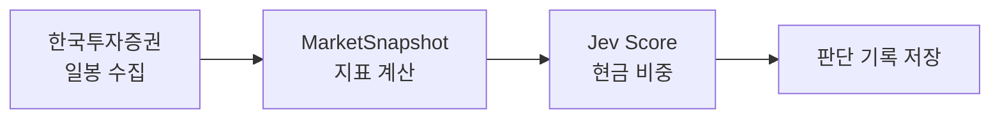
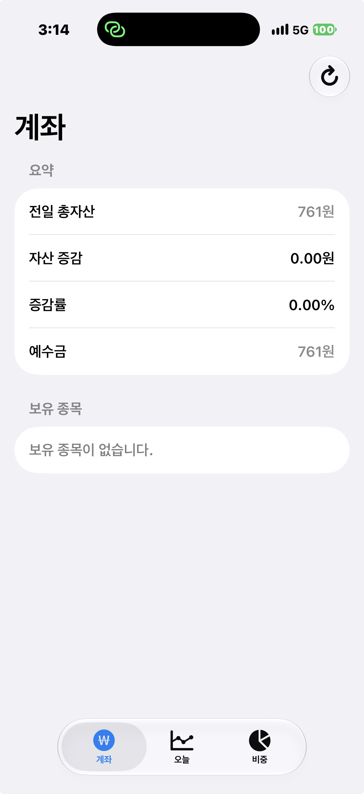
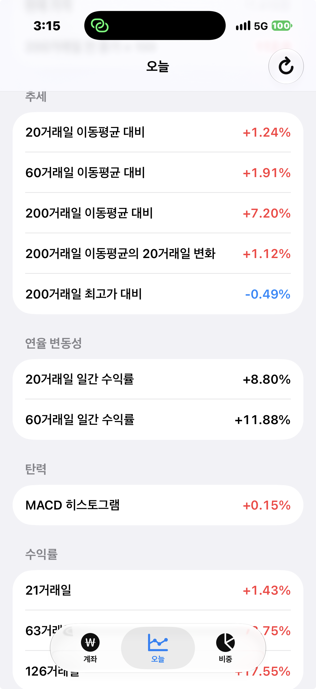
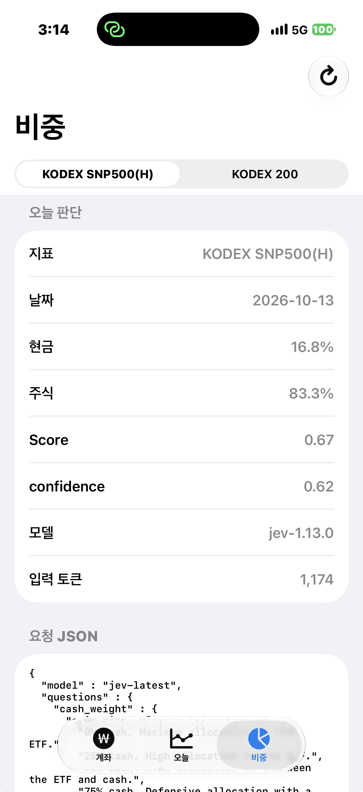
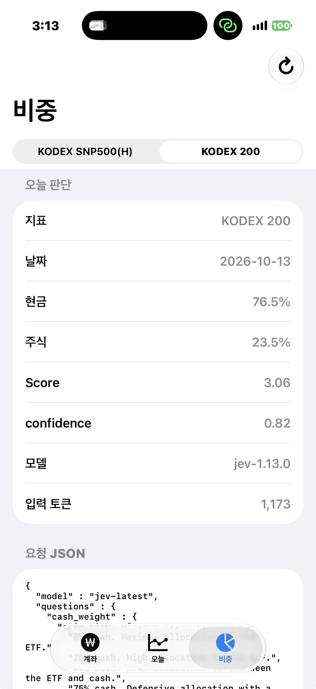

# MoneyPrinter

코스피에 상장된 ETF 일봉에서 아래 지표만 계산하고, 그 값을 TypeSafe의 판단 모델 **Jev**에 넘겨 시장 상황을 읽게 한 뒤 현금 보유 비율을 정하는 SwiftUI 앱입니다. 일봉 시계열이나 차트 전체는 보내지 않습니다. 주문은 아직 넣지 않습니다.

- 종목 코드, 마지막 거래일, 종가
- 200거래일 전 종가를 100으로 둔 가격
- 20·60·200거래일 이동평균 대비 종가 괴리
- 200거래일 이동평균이 20거래일 동안 변한 정도
- 20·60거래일 일간 수익률의 연율 변동성
- 최근 200거래일 최고가 대비 종가
- 21·63·126거래일 수익률
- MACD 히스토그램(12·26·9)의 종가 대비 퍼센트

판단에 쓰는 종목은 두 개입니다.

| 화면 이름       | 종목                | 코드     |
| --------------- | ------------------- | -------- |
| KODEX SNP500(H) | KODEX 미국S&P500(H) | `449180` |
| KODEX 200       | KODEX 200           | `069500` |

오늘 탭은 `449180`만 보여 줍니다. 비중 탭에서 둘 중 하나를 고릅니다.

## 동작



1. 국내 일봉을 기간을 나눠 받아 220거래일(200거래일 지표 + 200일 이동평균의 20거래일 변화)을 모읍니다. 한 번에 약 100건입니다.
2. 모은 일봉으로 정해 둔 지표만 계산해 `MarketSnapshot`을 만듭니다. 종가 목록은 Jev에 넣지 않습니다.
3. Jev `systemone` Score 질문에 이 스냅샷과 현금 0·25·50·75·100% 기준을 보냅니다. Jev는 지표를 함께 보고 지금 시장에 맞는 현금 비중을 고릅니다.
4. 현금 비중은 `score / 4`입니다. 0은 전액 주식, 1은 전액 현금입니다. `confidence`는 기록하고 보여 주지만, 비중 계산에는 쓰지 않습니다.
5. 요청 JSON, 응답 JSON, 지표, 모델 이름, 입력 토큰을 저장합니다.

비중 탭을 열거나, 종목을 바꾸거나, 새로고침할 때마다 Jev를 다시 호출합니다. 하루 한 번 제한은 검증 중이라 빼 두었습니다. 같은 날 같은 종목의 기록은 가장 최근 호출로 바뀌고, 그 이전 날짜는 남습니다.

저장 위치는 앱의 Application Support 안 `MoneyPrinter/cash-weights.json`입니다. 키는 `yyyy-MM-dd|종목코드`입니다.

## 지표

Jev가 시장 상황을 파악하도록, 일봉 종가와 고가로 아래 지표만 계산해 보냅니다. JSON 키는 줄임말 없이 계산 정의를 적습니다.

```swift
enum CodingKeys: String, CodingKey {
    case ticker = "index_symbol"
    case asOf = "last_trading_day"
    case latestClosingPrice = "latest_closing_price"
    case priceIndexed = "price_with_close_200_trading_days_ago_set_to_100"
    case priceVsMa20Pct = "percent_difference_from_20_trading_day_moving_average"
    case priceVsMa60Pct = "percent_difference_from_60_trading_day_moving_average"
    case priceVsMa200Pct = "percent_difference_from_200_trading_day_moving_average"
    case ma200Slope20dPct = "percent_change_of_200_trading_day_moving_average_over_prior_20_trading_days"
    case volatility20dPct = "annualized_percent_volatility_of_daily_returns_over_20_trading_days"
    case volatility60dPct = "annualized_percent_volatility_of_daily_returns_over_60_trading_days"
    case drawdownFrom200dHighPct = "percent_change_from_highest_high_of_last_200_trading_days"
    case return1mPct = "percent_return_over_prior_21_trading_days"
    case return3mPct = "percent_return_over_prior_63_trading_days"
    case return6mPct = "percent_return_over_prior_126_trading_days"
    case macdHistogramAsPercentOfClose = "histogram_of_12_minus_26_trading_day_exponential_moving_average_as_percent_of_closing_price"
}
```

## 화면

| 탭   | 하는 일                                                     |
| ---- | ----------------------------------------------------------- |
| 계좌 | 국내 주식 잔고                                              |
| 오늘 | `449180`의 현재 가격과 지표                                 |
| 비중 | 선택한 ETF의 Jev 판단, 요청·응답 JSON, 지표, 이전 날짜 기록 |

### 계좌 현황



### 오늘기준 지표 계산



### 비중

KODEX 미국S&P500(H)와 KODEX 200을 고릅니다.




## 한국투자증권 Open API

시세와 잔고는 [한국투자증권 KIS Developers](https://apiportal.koreainvestment.com) Open API를 씁니다.

| 서버     | 주소                                   |
| -------- | -------------------------------------- |
| 실전투자 | `openapi.koreainvestment.com:9443`     |
| 모의투자 | `openapivts.koreainvestment.com:29443` |

`URL_BASE`에는 `https://`를 넣지 않습니다. `//`가 xcconfig 주석이 됩니다. 예제 설정의 기본값은 모의투자 주소입니다.

지금 코드의 `APIConfigManager.isDemo`는 `false`입니다. 잔고 조회 `tr_id`는 실전 코드를 씁니다. 모의투자 서버를 쓰면 이 값도 `true`로 맞춰야 합니다.

앱이 실제로 호출하는 API는 다음과 같습니다.

| 용도           | 메서드·경로                                                           | tr_id                               |
| -------------- | --------------------------------------------------------------------- | ----------------------------------- |
| 접근 토큰      | `POST /oauth2/tokenP`                                                 | -                                   |
| 국내 ETF 일봉  | `GET /uapi/domestic-stock/v1/quotations/inquire-daily-itemchartprice` | `FHKST03010100`                     |
| 국내 주식 잔고 | `GET /uapi/domestic-stock/v1/trading/inquire-balance`                 | 실전 `TTTC8434R` / 모의 `VTTC8434R` |

국내 일봉의 `fid_org_adj_prc`는 `1`입니다. 접근 토큰은 키체인에 저장하고, 만료 전에 다시 씁니다.

해외 지수 일봉, 해외 잔고, 현재가, 재무 조회용 엔드포인트도 코드에 있습니다. 현금 비중 판단은 국내 ETF 일봉만 사용합니다. 주문 API는 없습니다.

## Jev

`POST https://api.typesafe.ai/v1/systemone`에 Score 질문 하나를 보냅니다. 질문 ID는 `cash_weight`이고, 모델은 `jev-latest`입니다.

기준은 현금 비중 다섯 칸입니다. 지표로 칸을 고르는 규칙은 적지 않고, Jev가 스냅샷을 보고 확률을 나눕니다. 두 종목의 질문 본문은 같고, 첫 문장의 ETF 이름만 다릅니다.

- `0% cash. Maximum allocation to the ETF.`
- `25% cash. High allocation to the ETF.`
- `50% cash. Balanced allocation between the ETF and cash.`
- `75% cash. Defensive allocation with a high cash reserve.`
- `100% cash. Maximum allocation to cash.`

`score`는 0부터 4까지 칸 번호의 확률 가중 평균이라 소수가 될 수 있습니다. 현금 비중은 그 값을 4로 나눈 뒤 0과 1 사이로 자릅니다. 응답의 `model`과 입력 토큰도 함께 저장합니다.

## 아직 없는 것

- 목표 비중과 계좌 잔고를 비교하는 리밸런싱
- 매수·매도 주문
- 최소 변경 폭, 하루 한 번 판단, 장중에만 주문 같은 실행 안전장치

## 프로젝트 구조

```
MoneyPrinter/
├── MoneyPrinter/
│   ├── Core/
│   │   ├── Networking/          # HTTP, 재시도, 에러
│   │   └── Storage/             # 키체인
│   ├── Features/
│   │   ├── Jev/                 # systemone 클라이언트와 Score 모델
│   │   ├── KoreaInvestment/     # 시세, 잔고, 토큰, 설정
│   │   └── Trading/             # MarketSnapshot, 현금 비중, 기록
│   └── UI/                      # 계좌, 오늘, 비중 탭
├── Info.plist                   # $(APP_KEY) 등 빌드 설정 참조
├── MoneyPrinter.xcconfig
├── Config.example.xcconfig
└── Config.xcconfig              # 실제 키. git에 올라가지 않음
```

## 시작하기

1. 설정 파일을 만듭니다.

   ```bash
   cp Config.example.xcconfig Config.xcconfig
   ```

2. `Config.xcconfig`에 값을 넣습니다. [TypeSafe 콘솔](https://console.typesafe.ai/keys)의 `TYPESAFE_API_KEY`, [KIS Developers](https://apiportal.koreainvestment.com)의 `APP_KEY`, `APP_SECRET`, `CANO`, `ACNT_PRDT_CD`, `URL_BASE`입니다.

3. Xcode에서 `MoneyPrinter.xcodeproj`를 열고 앱을 다시 빌드합니다. 키는 `Info.plist`의 `$(변수)`로 들어가므로, 값을 바꾼 뒤에는 다시 빌드해야 합니다.

## 참고

- [TypeSafe API 문서](https://docs.typesafe.ai/api)
- [Jev 모델 정보](https://docs.typesafe.ai/models)
- [한국투자증권 KIS Developers](https://apiportal.koreainvestment.com)
- [한국투자증권 Open API 공식 예제](https://github.com/koreainvestment/open-trading-api)

## 주의

이 프로젝트는 개인 학습과 실험용입니다. 투자 판단과 그 결과의 책임은 사용자에게 있습니다. 주문은 아직 연결되지 않았습니다.
